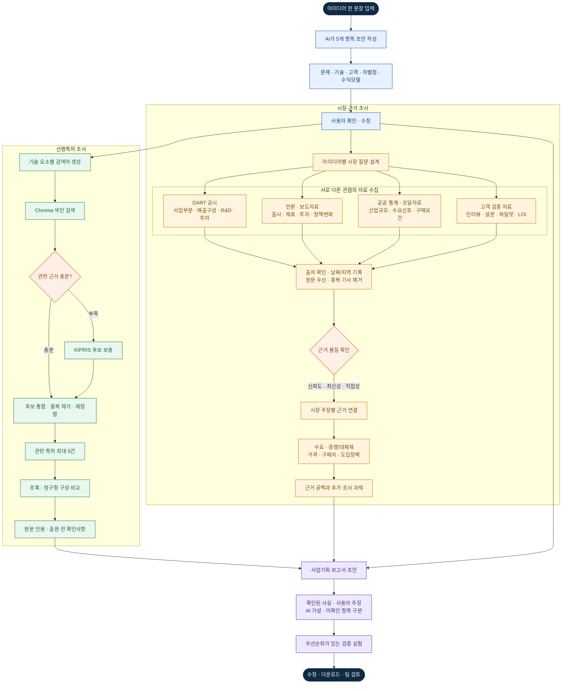

# IdeaLens 발표용 서비스 워크플로우

## 한 문장 소개

**IdeaLens는 기술 아이디어를 특허·시장 근거와 대조하고, 확인된 사실과 가설을 구분한 사업기획 초안과 다음 검증 계획으로 바꿔주는 초기 검토 도구입니다.**

## 발표에서 보여줄 큰 흐름



시장 조사는 **자료를 많이 모으는 과정이 아니라 서로 다른 증거를 교차 확인하는 과정**입니다. DART는 기업의 사업·재무·투자 맥락, 언론과 보도자료는 시점별 변화, 공공 통계·조달자료는 산업 및 구매 조건, 고객 검증 자료는 실제 문제와 지불 의사를 확인합니다. 자료마다 원문·날짜·대상 지역을 기록하고, 신뢰도·최신성·아이디어와의 직접성을 따져 주장에 연결합니다. 각 자료가 입증하지 못하는 범위도 보고서에 남깁니다.

## 사용자 경험의 변화

| 기존에 막히는 지점 | IdeaLens의 다음 단계 |
|---|---|
| 아이디어가 한 문장뿐이라 조사 질문이 막연함 | 5개 항목 초안을 만들고 사용자가 확인·수정 |
| 특허 검색 결과를 읽어도 내 아이디어와 무엇이 비슷한지 모름 | 초록·청구항의 기술 구성을 근거 문장과 함께 비교 |
| 시장 성장률 숫자만 보고 사업성이 있다고 착각함 | 고객·구매자·대체재·가격·도입장벽 자료를 나누고 출처를 표시 |
| AI 점수가 높아도 왜 그런지 확인하기 어려움 | 점수보다 근거 수준과 미확인 가정을 보여주고 보고서 초안으로 연결 |
| 검색 후 무엇을 해야 할지 불분명함 | 고객 인터뷰·성능 시험·가격 실험 등 구체적인 검증 액션 제시 |

## 보고서가 완성되는 순서

```text
아이디어 초안
  → 사용자가 확정한 문제·기술·고객·차별점·수익 가설
  → 선행 특허 최대 5건의 근거 연결 비교
  → 시장의 고객·경쟁·가격·도입 조건 근거
  → 확인된 사실 / 사용자 주장 / AI 가설 / 조사 공백 분리
  → 우선순위가 있는 검증 계획
  → 공유·수정 가능한 사업기획 보고서
```

각 내용은 네 가지 출처 상태로 표현합니다. `사용자 제공`은 입력·확인한 정보, `공개 자료 확인`은 날짜와 링크가 있는 자료, `AI 가설`은 자료를 해석한 제안, `추가 검증 필요`는 아직 증거가 없는 주장입니다. 보고서의 모든 핵심 주장은 가능한 한 특허 번호나 시장 자료 번호로 역추적할 수 있어야 합니다.

## 사업성 평가에 쓰는 데이터

사업성을 하나의 웹 검색이나 시장 규모 숫자로 판단하지 않습니다. 보고서가 다룰 데이터 묶음은 다음과 같습니다.

| 근거 묶음 | 중요한 데이터 | 가장 강한 확인 방법 |
|---|---|---|
| 문제·고객 | 문제 빈도, 불편 비용, 사용자와 구매자의 차이, 현재 대안 | 실제 잠재고객 인터뷰와 관찰 |
| 수요 | 파일럿 요청, 사용 의향, 도입 문의, 재사용 | 고객 실험, LOI, 파일럿·사용 데이터 |
| 경쟁·가격 | 대체 제품 사양, 가격, 설치·운영 비용, 전환 장벽 | 공급자 자료와 고객의 가격 비교 |
| 경제성 | 지불 주체, 구매 주기, 단가, 원가, 마진 | 견적, BOM, 가격 실험 |
| 구현·도입 | 시제품 성능, 안전성, 인증, 운영 인프라와 통합 비용 | 시험 결과와 인증·조달 요건 |
| 지식재산 | 선행 청구항, 권리 상태·국가·시점, 공개 이력 | KIPRIS 원문 및 전문가 검토 |

**DART의 역할:** 상장 경쟁사가 정해졌다면 사업 부문·재무·연구개발·설비투자 자료로 경쟁 환경을 보완합니다. 상장사 공시만으로 초기 고객의 지불 의사를 증명할 수는 없습니다.

**뉴스의 역할:** 정책, 제품 출시, 제휴 등 변화를 발견하는 보조 신호입니다. 원문 날짜와 보도 주체를 기록하고 동일 보도자료의 재전송 기사를 중복 증거로 세지 않습니다.

**MVP 결정:** 일주일 구현에서는 DART 연동이나 뉴스 스크래핑을 추가하지 않습니다. 먼저 출처를 추적할 수 있는 시장 검색과 직접 고객 검증 항목을 보고서에 연결합니다. 고객이 경쟁사 재무 추적이나 산업 변화 모니터링을 반복적으로 필요로 한다는 증거가 나오면 다음 단계에서 DART·뉴스를 추가합니다.

## 3분 시연 시나리오

입력 예시: “전기차 배터리 급속충전 기술로 충전 시간을 크게 줄이고 싶다.”

1. 한 문장 입력에서 문제·기술·고객·차별점·수익 모델 초안이 생성되는 것을 보여줍니다. “50% 단축” 등 검증되지 않은 수치는 목표 또는 사용자 주장으로 남기고, 사용자가 수정할 수 있게 합니다.
2. 생성된 기술 요소를 확인한 뒤 특허 결과를 엽니다. 원형 지도에서 관련 특허를 선택하고, 공개번호·청구항 보유 여부·실제 근거 구절을 팝업으로 확인합니다.
3. 비교 결과가 등록 가능성이나 침해 여부를 단정하지 않는 이유를 설명합니다. 검색된 청구항은 추가 검토가 필요한 선행 구성과 질문을 제시하는 역할입니다.
4. 시장 자료에서 고객 유형, 대체 기술, 가격 또는 도입 조건과 자료 날짜를 확인합니다. 시장 성장 수치가 있더라도 실제 구매 의사와 구분합니다.
5. 사업기획 보고서에서 확인된 자료, AI 가설, 비어 있는 질문을 확인합니다. 예를 들어 충전 성능 시험, 배터리 안전·인증, 설비 호환성, 구매자 인터뷰를 다음 액션으로 제시합니다.
6. 초안을 다운로드하거나 수정 대상으로 표시하며, 사람이 확인할 수 있는 문서가 완성된 점을 보여줍니다.

검색된 특허나 시장 자료가 부족한 경우에는 이를 숨기지 않습니다. “자료 부족” 자체를 보고서에 기록하고, 어떤 추가 데이터가 있어야 판단을 진행할 수 있는지 보여주는 것이 신뢰를 높입니다.

## 발표자료 권장 구성

| 장표 | 제목 | 전달할 한 가지 메시지 |
|---|---|---|
| 1 | 아이디어는 많은데 검토 근거는 흩어져 있다 | 예비 창업 검토에서 특허·시장·고객 자료를 잇기 어렵다 |
| 2 | 한 문장을 검토 가능한 질문으로 바꾼다 | AI 초안 후 사용자가 다섯 항목을 확인한다 |
| 3 | 특허와 시장 근거를 따로 검색해 연결한다 | 청구항 근거와 시장 출처를 같은 아이디어에 연결한다 |
| 4 | 점수 대신 사실·가설·공백을 보여준다 | 미검증 주장은 낮은 신뢰로 남기고 결론을 과장하지 않는다 |
| 5 | 다음 실험까지 제안하는 사업기획 초안 | 조사 결과가 고객 인터뷰·성능 시험·가격 검증으로 이어진다 |
| 6 | 반복 검토 조직에서 채택을 검증한다 | 창업지원단 인터뷰와 동일 아이디어 비교로 시간·재사용을 측정한다 |
| 7 | MVP의 한계와 다음 단계 | 법률 판단·실제 수요 검증은 전문가와 고객 실험이 필요하며 DART·뉴스는 수요 확인 후 추가한다 |

발표에서 성능 수치가 아직 측정되지 않았다면 수치를 만들지 않습니다. 대신 평가할 샘플 수, 측정 방법, 다음 파일럿 기준을 제시합니다.
