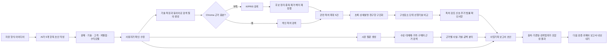

# IdeaLens 팀 계획

4명이 7일 안에 완성할 목표는 “아이디어가 좋은지 AI가 점수로 단정하는 서비스”가 아닙니다. 사용자의 기술 아이디어를 특허·시장 근거와 함께 검토하고, 창업지원 담당자나 예비 창업자가 다음 검증을 결정할 수 있는 **출처가 추적되는 사업기획 초안**을 만드는 서비스입니다.

## 제품 흐름

이 흐름의 핵심은 특허 검색과 시장 조사를 한데 섞어 “사업성 점수”로 압축하지 않는 것입니다. 특허 자료는 기술의 선행 공개와 청구항 구성 비교에 쓰고, 시장 자료는 고객·대체재·가격·도입 조건을 확인하는 데 씁니다. 각 문장은 근거 유형을 표시합니다.

| 표시 | 뜻 | 예시 |
|---|---|---|
| 사용자 제공 | 사용자가 입력하거나 확인한 정보 | “현재보다 충전 시간을 50% 줄이고 싶다” |
| 공개 자료 확인 | 날짜와 출처 링크가 있는 공개 자료에서 확인 | 경쟁 제품의 공개 사양·가격, 기업 공시 |
| AI 가설 | 자료를 바탕으로 한 해석이나 초안 | “충전사업자가 초기 구매자일 수 있음” |
| 추가 검증 필요 | 공개 자료만으로 결론 낼 수 없음 | 실제 구매 의사, 현장 운영비, 성능 재현성 |

50% 단축 같은 표현은 목표인지 측정된 성능인지 구분합니다. 출처가 없는 목표를 시장에서 검증된 효익처럼 보고서에 쓰지 않습니다.

## 사업기획 보고서가 답할 질문

사용자는 분석 결과에서 다음 질문에 답할 수 있어야 합니다.

1. **무엇을 해결하는가?** 문제, 사용 상황, 현재 대안과 불편을 요약합니다.
2. **어떻게 해결하는가?** 기술 구성과 차별화 주장을 정리하고, 관련 특허의 초록·청구항에서 확인한 유사 구성에 연결합니다.
3. **누가 도입하고 비용을 내는가?** 사용자와 구매자를 구분하고, 대상 고객·구매 기준·수익모델을 가설로 제시합니다.
4. **시장 근거는 어느 정도인가?** 고객 수요, 대체재, 가격, 도입 장벽을 출처·날짜와 함께 보여주고 지역·기간·자료 범위를 밝힙니다.
5. **무엇을 아직 모르는가?** 고객 인터뷰, 시제품 성능, 원가, 인증·규제, 지식재산권 검토 등 결론에 필요한 공백을 구체화합니다.
6. **다음에 무엇을 검증할까?** 가장 위험한 가설부터 저비용 실험으로 바꾸어 담당자·방법·판정 기준을 제안합니다.

보고서 초안은 아래 목차로 구성합니다.

| 보고서 영역 | 들어갈 내용 | 근거 또는 표기 |
|---|---|---|
| 요약 | 아이디어, 핵심 기회, 가장 큰 미확인 위험 | 사용자 입력 + 주요 근거 2~3개 |
| 문제와 고객 | 문제 상황, 사용자·구매자, 현재 대안 | 입력 정보와 AI 가설 구분 |
| 제품·기술 | 동작 방식, 주요 구성요소, 목표 성능 | 측정 결과가 없으면 목표로 표시 |
| 선행기술 검토 | 관련 특허 최대 5건, 유사·차이 구성, 원문 위치 | 공개번호, 문서 유형, 청구항 보유 여부, 출처 링크 |
| 시장과 경쟁 | 수요 신호, 경쟁·대체재, 가격, 도입 장벽 | 출처 URL, 게시·공시일, 조사 기준일 |
| 사업모델 가설 | 구매자, 과금 단위, 가격 검증 방법 | 확인된 가격과 제안 가격을 분리 |
| 실행 가능성 | 기술 실증, 원가, 인증·운영 조건 | 확인/미확인 체크 |
| 위험과 다음 실험 | 핵심 가정, 검증 방법, 성공 판정 기준 | 우선순위와 권장 순서 |
| 참고 자료 | 특허와 시장 자료의 전체 목록 | 번호, 출처, 날짜, 확인 범위 |

MVP에서는 보고서를 Markdown/JSON으로 생성하고 다운로드할 수 있게 합니다. 편집 기능은 사용자가 내용을 보정하도록 하되, 수정한 문장을 자동으로 검증된 사실로 바꾸지 않습니다. PDF·공유·조직별 검토 이력은 핵심 흐름을 검증한 뒤 확장합니다.

## 사업성 데이터는 무엇을 모아야 하나

큰 시장 규모 숫자 하나보다, 실제 구매와 실현 가능성을 설명하는 자료가 유용합니다.

| 데이터 | 확인할 항목 | 우선 수집 방법 |
|---|---|---|
| 고객 문제 | 발생 빈도·심각도·현재 해결 비용·현재 대안 | 고객 인터뷰, 설문, 현장 관찰 |
| 수요 증거 | 실제 사용 의향, 파일럿·도입 문의, 재구매/이용 데이터 | 인터뷰 후 파일럿 제안, LOI, 사용 로그 |
| 구매 구조 | 사용자, 의사결정자, 예산 보유자, 구매 주기 | 구매 담당자 인터뷰, 조달·입찰 자료 |
| 경쟁·대체재 | 제품 사양, 가격, 구축 방식, 고객군, 한계 | 제조사 자료, 가격표, 공개 제품 자료 |
| 가격·단위경제 | 지불 의사, 단가, 재료·설치·운영 비용, 마진 | 가격 실험, 견적, BOM·원가 산정 |
| 기술 실현성 | 성능 기준선, 반복 실험, 안전·내구·확장성 | 시제품 시험과 제3자 시험 자료 |
| 도입 장벽 | 인증, 규제, 인프라, 구매 절차, 전환 비용 | 정부·인증기관 자료, 고객·전문가 인터뷰 |
| 지식재산 위험 | 청구항 구성, 권리 상태·시점·국가, 공개 이력 | KIPRIS 원문과 전문가 검토 |

시장 근거는 `출처의 신뢰도`, `아이디어와의 직접성`, `최신성`, `지역·대상 범위`를 함께 관리합니다. 자료가 있다고 해서 고객 수요가 입증되는 것은 아닙니다. 예를 들어 업계 성장 전망은 배경 설명이며, 우리 고객의 구매 의사 증거와 별도로 표시합니다.

### DART와 뉴스는 어떻게 쓸까

DART는 경쟁사나 상장 기업이 식별된 뒤 보조 데이터로 붙이는 편이 좋습니다. 사업 부문, 매출 구성, 연구개발비, 설비투자, 위험 요인, 고객·시장 설명은 사업 환경을 이해하는 데 도움을 줄 수 있지만, 비상장 초기 고객의 지불 의사나 새 제품에 대한 수요를 직접 증명하지 않습니다. DART를 매출 예측의 자동 입력값처럼 사용하지 않습니다.

뉴스는 신제품 출시, 제휴, 투자, 규제 변화 같은 시점별 신호를 보완합니다. 같은 보도자료를 받아쓴 기사를 중복 집계하지 않고, 원문·발행일·보도 주체를 남깁니다. 한 건의 기사나 기업 홍보자료는 독립적인 시장 검증으로 계산하지 않습니다.

**7일 MVP에서는 DART 수집기나 뉴스 스크래퍼를 새로 만들지 않습니다.** 웹 검색에서 직접 출처를 확인할 수 있는 시장 자료와 사용자 제공 근거를 먼저 보고서에 연결합니다. DART는 해당 산업의 상장 경쟁사 비교가 반복적으로 필요하다는 인터뷰 결과가 있을 때 다음 단계로 추가합니다. 뉴스는 정책·경쟁 변화 모니터링이 제품의 반복 사용을 높인다는 신호가 확인된 뒤 검토합니다.

## 특허 결과를 안전하고 유용하게 보여주기

특허 검색은 선행기술 조사를 돕는 탐색 기능입니다. 벡터 유사도나 상위 결과 순위는 신규성·진보성·침해·등록 가능성의 법률 판단이 아닙니다. 특허 **등록 가능성** 검토와 타인의 권리 **침해/FTO** 검토는 질문과 조사 범위가 다르므로, 보고서에서 합쳐 단정하지 않습니다.

관련 특허는 검색 결과가 실제로 확보된 수만큼(최대 5건) 보여줍니다. 각 카드에 공개번호, 문서 종류, 공개·출원일, 청구항 본문 확보 여부, 관련 근거 문장과 원문 팝업을 연결합니다. 자료가 초록에만 있으면 초록 기반 비교임을 표시하고, 청구항 단위 검토가 필요한 문서는 법률 확인 과제로 올립니다.

전기차 급속충전 예시에서 “충전시간 50% 단축”을 입력하면 제품 성능 사실이 아니라 목표 주장으로 시작합니다. 시스템은 충전 제어·열관리·전력변환 등 검색 관점을 제안하고 사용자가 확인하도록 합니다. 검색된 특허의 구체 구성을 비교한 뒤, 시장 자료에서 충전사업자·차량/배터리 업체의 구매 맥락과 대체 기술을 확인합니다. 보고서는 성능 검증, 배터리 안전·인증, 설비 호환성, 원가·설치비, 구매자 인터뷰를 주요 미확인 과제로 표시합니다. 특허 등록 또는 침해 여부는 결론 내리지 않습니다.

## 사용자와 채택 가설

초기 고객은 대학 창업지원단·창업보육센터·기술사업화 조직처럼 여러 아이디어를 반복해서 검토하는 팀으로 둡니다. 개인 사용자용 범용 AI 챗봇보다, 근거를 검토하고 팀에 공유할 보고서 초안을 만드는 업무 흐름이 뚜렷합니다.

채택 여부는 “점수가 마음에 드는가”보다 다음으로 검증합니다.

- 담당자가 같은 아이디어를 기존 방식과 IdeaLens로 검토했을 때 준비 시간이 줄어드는가.
- 특허와 시장 근거의 링크를 실제로 열어 확인하는가.
- 보고서 초안의 어떤 부분을 수정하고, 수정 후 내부 검토에 재사용하는가.
- 담당자가 다음 아이디어도 입력하거나 동료에게 결과를 공유하는가.
- 파일럿 비용, 아이디어 기밀성, 데이터 보존 조건을 협의할 의사가 있는가.

첫 검증은 창업지원 담당자 5명 인터뷰와 샘플 아이디어 5건의 수동 품질 평가로 시작합니다. 검토 시간을 직접 기록하고, 특허 상위 결과의 전문가 관련성·시장 출처의 적합성·가설 구분·보고서 수정률을 기록합니다. 표본이 작은 미니 프로젝트 결과를 정확도나 시장 성과 수치로 과장하지 않습니다.

## 4인 역할과 7일 진행

| 담당 | 책임 | 발표에서 보여줄 산출물 |
|---|---|---|
| 1. 프론트엔드·제품 | 자유 입력, 자동작성 확인/수정, 결과 시각화, 보고서 미리보기·다운로드 | 한 번의 입력에서 검토 가능한 화면으로 이어지는 시연 |
| 2. 백엔드·통합 | API 계약, 파이프라인 조정, 근거 메타데이터, 제한·오류 처리, 보고서 스키마 | 상태·출처·공백이 보존되는 분석 결과 JSON |
| 3. 특허 데이터·검색 | KIPRIS 조회, 오프라인 Chroma 색인, 청구항/문서 청킹, 재정렬 | 검색범위와 원문 근거를 설명할 수 있는 특허 카드 |
| 4. 시장 조사·평가 | 시장 검색 질의, 출처 품질, 보고서 프롬프트, 샘플 평가 | 고객·경쟁·가격 근거와 검증 과제 |

| 일자 | 완성할 것 | 종료 기준 |
|---|---|---|
| 1일차 | 사용자·데모 시나리오 확정, 공통 요청/응답 JSON, KIPRIS·모델 설정 확인 | 팀원 모두 같은 샘플 입력과 스키마 사용 |
| 2일차 | 아이디어 자동 구조화/수정 UI, API 골격, 검색 질의 생성 | 입력부터 파싱 결과까지 시연 |
| 3일차 | 오프라인 Chroma 검색과 KIPRIS 보충 검색, 상위 특허 화면 | 검색범위·중복·검색 실패가 표현됨 |
| 4일차 | 청구항/초록 근거 비교, 인용 링크, 특허 검토 체크리스트 | 분석 문장에서 원문 근거로 이동 가능 |
| 5일차 | 시장 근거 수집, 사실/가설 구분, 사업기획 보고서 초안 | 아이디어·특허·시장 근거가 한 결과물로 연결 |
| 6일차 | 샘플 5건 평가, 점수·보류·출처 검토, README와 실행 절차 | 실패 흐름과 근거 부족 흐름을 확인 |
| 7일차 | 기능 동결, 발표 자료와 라이브 시연 리허설 | 네 명 모두 전체 가치 흐름을 설명 가능 |

첫날 API 응답에 `claim`, `evidence_type`, `source_id`, `source_url`, `source_date`, `coverage`, `confidence/limitations`를 합의합니다. 역할별 병렬 개발보다 이 공통 데이터 계약과 통합 가능한 작은 수직 흐름을 먼저 고정합니다.

## 발표 순서

발표는 기능 목록보다 사용자의 의사결정 흐름으로 설명합니다.

1. **문제:** 초기 기술 아이디어 검토는 특허 검색, 시장 자료, 고객 검증이 따로 흩어져 있고 근거와 가설이 섞이기 쉽습니다.
2. **해결:** IdeaLens는 한 번의 아이디어 입력으로 정리 가능한 초안을 만들고, 사용자가 확인한 뒤 특허·시장 근거를 모읍니다.
3. **신뢰:** 특허 청구항과 시장 출처를 추적하고, 확인된 사실·AI 가설·추가 확인 과제를 구분합니다.
4. **결과:** 단일 점수 대신 사업기획 보고서 초안과 다음 검증 실험을 제공합니다.
5. **고객과 채택:** 여러 아이디어를 다루는 창업지원 조직의 검토 시간을 줄이고 내부 공유가 쉬워지는지 인터뷰·샘플 평가로 확인합니다.
6. **한계와 확장:** MVP는 예비 검토 도구입니다. 실제 수요는 고객 실험, 특허 법률 판단은 전문가 검토가 필요합니다. DART·뉴스는 고객 필요가 확인된 뒤 추가합니다.

시연은 자유 입력 → 자동 구조화 결과 확인 → 특허 상위 결과에서 원문 근거 열기 → 시장 근거의 출처와 조사 시점 확인 → 보고서에서 사실·가설·공백 확인 → 다음 실험을 다운로드 순서로 진행합니다. 사전에 준비한 정상 사례뿐 아니라, 특허 결과가 부족한 사례와 시장 근거가 빈약한 사례도 한 문장씩 보여주면 신뢰성을 설명하기 좋습니다.

## 핵심 지표

MVP의 성공은 색인한 특허 수나 모델 응답 길이로 판단하지 않습니다.

- 검색 상위 5건의 관련성: 분야를 이해하는 평가자가 아이디어별로 판정.
- 인용 유효성: 보고서의 출처가 실제 문서·시장 자료를 열고 주장을 뒷받침하는지.
- 근거 구분 품질: 사용자 입력, 공개 사실, AI 가설, 미확인 항목이 뒤섞이지 않는지.
- 검토 효율: 기존 검토와 같은 아이디어의 준비 시간을 직접 비교.
- 재사용 의향: 담당자가 보고서를 수정·공유하고 다음 아이디어에도 사용하려는지.

세션 저장만 제공하는 현재 MVP에서 장기 재방문을 입증했다고 말하지 않습니다. 재사용은 후속 파일럿에서 관찰합니다. 서비스 가치를 확인한 이후에만 조직 계정, 공유 이력, 보고서 보관, 자동 데이터 모니터링을 검토합니다.
